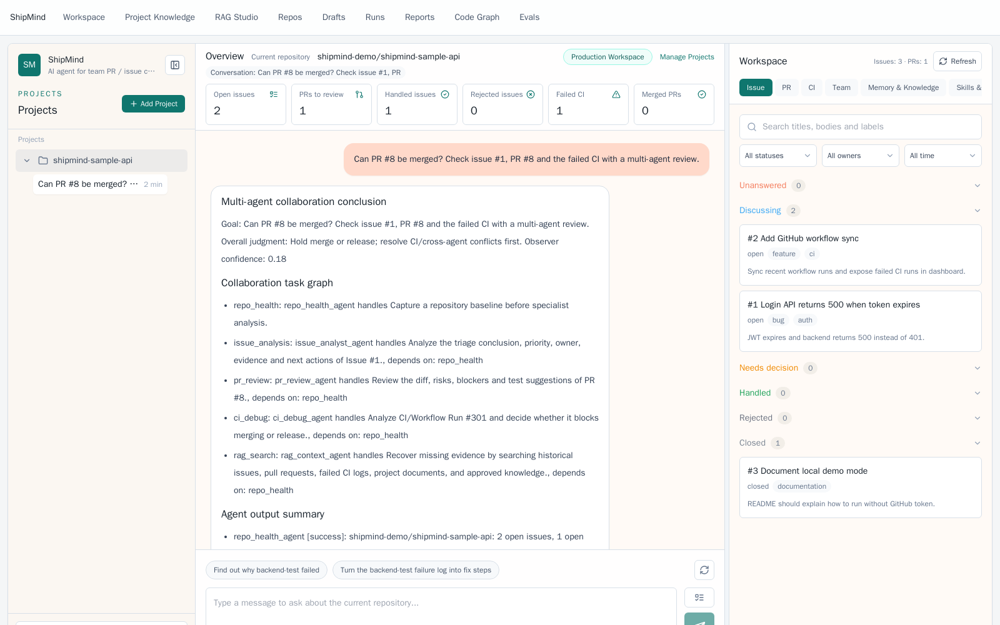
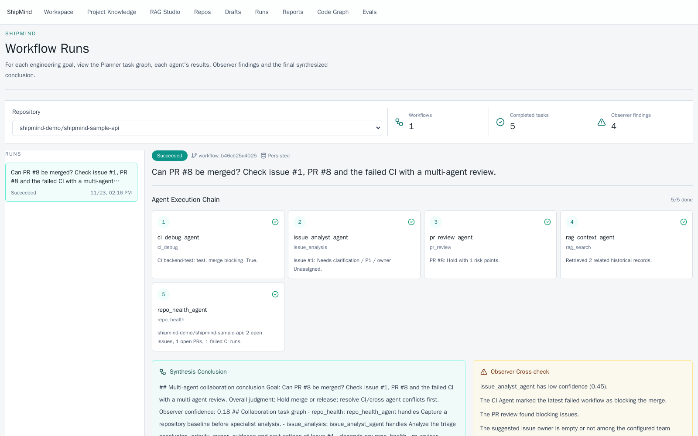
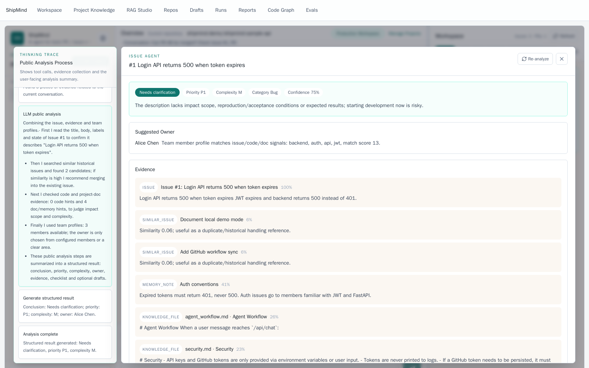
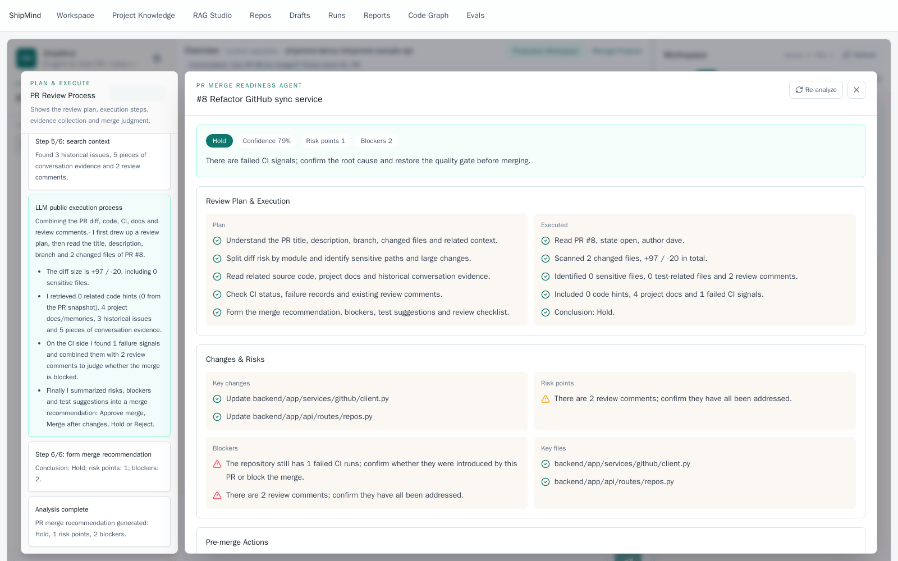
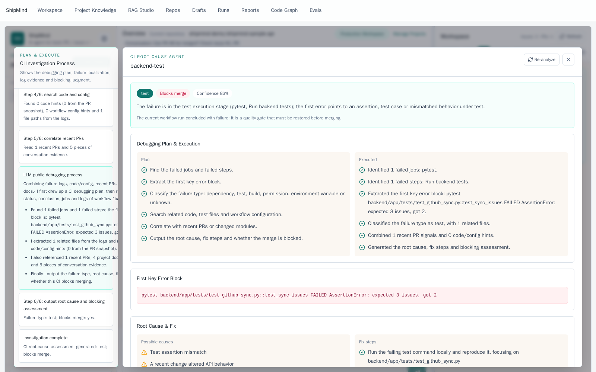
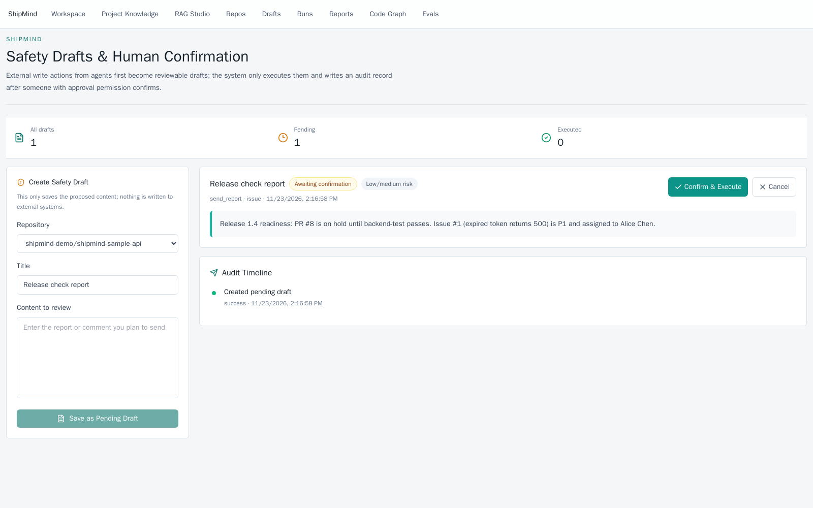
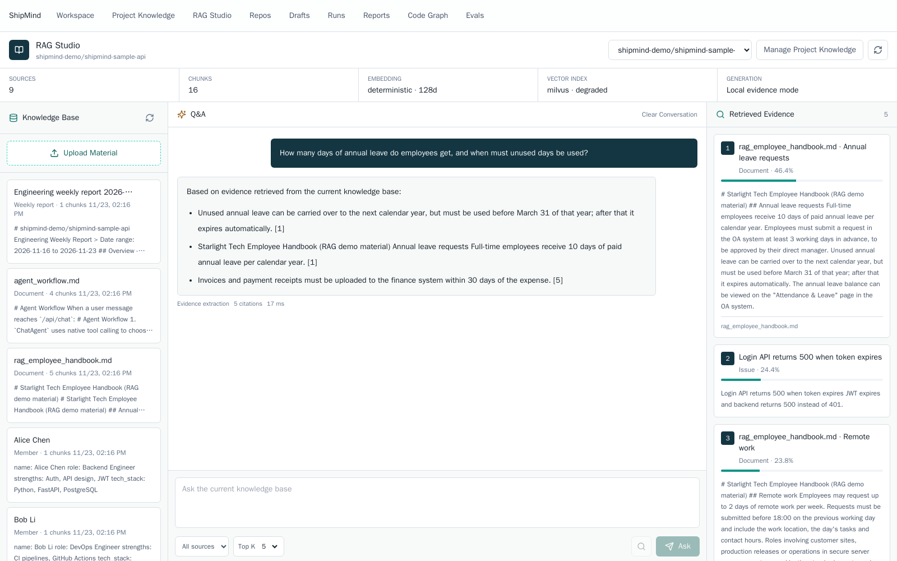
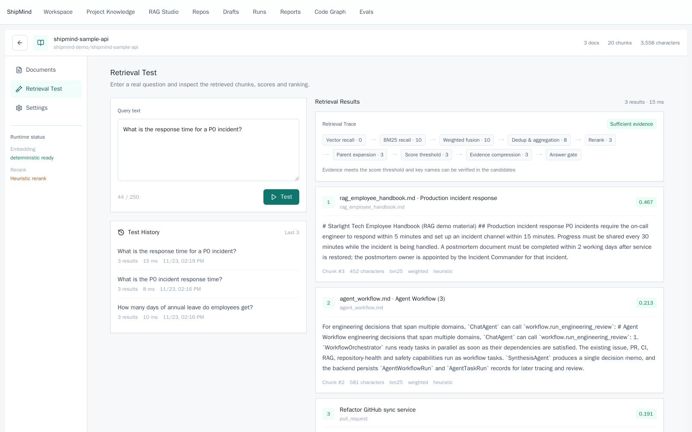
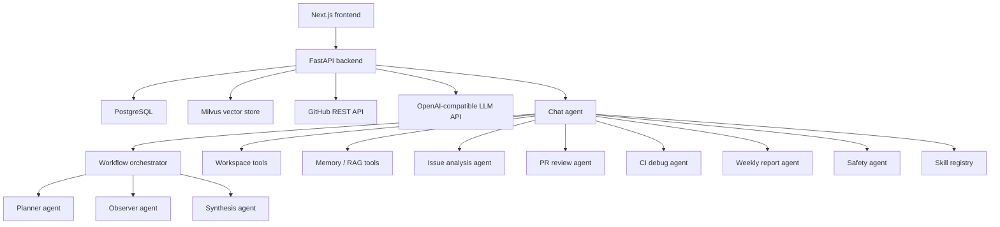

# ShipMind

ShipMind is a full-stack AI agent for engineering collaboration around GitHub pull requests and issues. It connects to repository data, analyzes issues, PR diffs, CI logs, the project knowledge base and the local workspace code, and returns structured recommendations along with safe action drafts.



## Screenshots

These screenshots come from the local demo mode (SQLite, seeded demo repository, deterministic embeddings, no LLM key), so they show the built-in fallback analysis. With an LLM configured, the same views show model-generated results.

### Multi-agent workflow

"Can PR #8 be merged?" fans out to the Planner, then the issue, PR, CI and RAG agents, then the Observer and Synthesis. Every run is persisted with its task graph, per-agent results and the Observer's cross-checks.



### Issue triage, PR review and CI debugging

Each analysis streams a public trace of the steps on the left and renders a structured result on the right.

| Issue triage | PR merge readiness |
| --- | --- |
|  |  |
| The owner is picked from configured team profiles, and the evidence comes from similar issues, memory notes and docs. | Graded P1/P2/P3 findings; any blocker downgrades the recommendation from "Approve merge". |

| CI root cause | Safety drafts |
| --- | --- |
|  |  |
| Pulls out the first key error block, classifies the failure and decides whether it blocks the merge. | External writes become drafts that a human must confirm, and every action is written to an audit log. |

### RAG knowledge base

| RAG Studio | Retrieval test |
| --- | --- |
|  |  |
| Answers carry numbered citations, with the retrieved evidence shown next to them. | The full retrieval trace: vector + BM25 recall, fusion, rerank, parent expansion, threshold and answer gate. |

## Features

- Connects to and syncs issues, pull requests, PR files, review comments, workflow runs, jobs and logs from GitHub repositories.
- **Issue analysis**: category, priority, complexity, suggested owner, duplicate candidates and action items.
- **PR review**: summary, key changes, risks, review checklist, test suggestions and files that need attention.
- **CI debugging**: failure type, likely causes, debugging steps and related context.
- **Agent chat**: `ChatAgent` uses native tool calling to chain workspace, memory, RAG, issue, PR, CI, weekly-report and safety tools.
- **Multi-agent workflow review**: `WorkflowOrchestrator` runs a Planner → specialist agents → Observer → Synthesis loop for PR readiness, blockers, prioritization and cross-domain engineering decisions.
- **Skill runtime**: selects a `SKILL.md` by explicit user request or trigger conditions and loads its full instructions and scoped resources only for the current task. Explicit skills are checked against their allowed tools; each specialist agent in a multi-agent run loads its own skill, and the version, activation reason, instruction digest and execution checks are written to the trace.
- **Workspace code tools**: safely list files, read files and search local code.
- **Focused RAG**: indexes issue descriptions, PR descriptions and review comments, failed CI logs, project docs, uploaded knowledge and approved long-term memory. Current code goes through workspace/lexical search, while team and live status go through structured queries.
- **Weekly reports**: generates engineering weekly reports.
- **Evals**: basic evals cover issue classification, PR coverage, RAG hit rate, tool schema readiness and structured output validation.

## Tech Stack

- **Backend**: Python 3.11+, FastAPI, Pydantic, SQLAlchemy, PostgreSQL, Milvus, httpx, LangChain.
- **Agent orchestration**: native tool calling plus specialist analysis agents.
- **Frontend**: Next.js, TypeScript, Tailwind CSS, React Query.
- **Infrastructure**: Docker Compose and `.env` configuration.

## Architecture



More detail lives in [docs/architecture/](docs/architecture/).

## Quick Start

```bash
cp .env.example .env
docker compose up -d postgres etcd minio milvus

cd backend
python -m venv .venv
source .venv/bin/activate        # Windows: .venv\Scripts\activate
pip install -r requirements.txt
uvicorn app.main:app --reload
```

In another terminal:

```bash
cd frontend
npm install
npm run dev
```

Default addresses:

- Backend: http://localhost:8000
- API docs: http://localhost:8000/docs
- Frontend: http://localhost:3000

## Running Tests

```bash
cd backend
pytest app/tests
```

The test suite does not need PostgreSQL, Milvus or an LLM key; it uses in-memory SQLite and fakes for external services. `git` and `ripgrep` should be on your `PATH`.

## RAG Knowledge QA

The project ships a complete RAG pipeline: a knowledge base creation wizard, document parsing, paragraph-aware chunking, embeddings, hybrid vector/keyword retrieval, reranking, retrieval tests, a QA studio, context assembly, evidence-grounded generation and numbered citations. It supports TXT, Markdown, PDF, DOCX, JSON, CSV and log files; duplicate files are skipped by SHA-256.

The chat pipeline uses hybrid RAG: before calling the ChatAgent, `ContextAssembler` retrieves evidence for the original question and injects it. Inside the reasoning loop the model can still call `rag.search_similar_documents` as a tool to rewrite the query, run several follow-up lookups against different sources and cross-check the answer across tool results.

Not all private data is vectorized. Only unstructured knowledge that needs cross-source semantic recall and gets reused goes into RAG. Source code and configuration follow the current checkout and are retrieved primarily via `workspace.search_code` and `workspace.read_file`. Structured or derived data such as issue/PR/CI status fields, team members and weekly reports is queried directly from the database or API. RAG returns candidate evidence; for live status and current code, answers are still verified against the authoritative source.

After upgrading from an older version, call `POST /api/rag/{repo_id}/reindex` once for each knowledge base. The rebuild clears old vectors and old conversation documents according to the new boundaries; deploying code alone does not delete existing indexes.

If you only want to try the pages, structured data and the model-free fallback answers, you can start a local SQLite demo environment on Windows with:

```powershell
.\scripts\start_rag.ps1
```

The script disables Milvus, uses deterministic embeddings and heuristic reranking, and turns off the demo knowledge base's `0.8` score threshold so that results aren't all filtered out when only the keyword branch is active. It is good for checking pages, upload parsing, relational storage, the keyword branch of hybrid search and citation display, but vector search status will show `degraded`, so it does not prove the full RAG pipeline works. To verify vector recall, hybrid retrieval and reindexing, start PostgreSQL, etcd, MinIO and Milvus as described in Quick Start.

Knowledge bases default to `Qwen/Qwen3-Embedding-0.6B` and `qwen3-rerank`. Install `backend/requirements-local-embedding.txt` to run Qwen embeddings locally; set `DASHSCOPE_API_KEY` and `RERANK_BASE_URL` to switch to DashScope `text-embedding-v4` and `qwen3-rerank`. If the default embedding dependencies are missing, the system raises a clear error rather than silently switching to a different vector space in production configurations; only the local demo script above explicitly selects deterministic embeddings. If `LLM_API_KEY` is configured, use `.\scripts\start_rag.ps1 -UseConfiguredLLM` to enable model generation.

RAG API:

```text
POST /api/rag/knowledge-bases
GET  /api/rag/knowledge-bases
GET  /api/rag/knowledge-bases/{repo_id}
POST /api/rag/knowledge-bases/{repo_id}/documents
POST /api/rag/knowledge-bases/{repo_id}/retrieval-tests
GET  /api/rag/{repo_id}/status
POST /api/rag/{repo_id}/search
POST /api/rag/{repo_id}/ask
POST /api/rag/{repo_id}/reindex
```

## ChatAgent RAGAS Evaluation

With the app running, open `http://127.0.0.1:3000/evals`, choose a repository, a fixed eval suite and Top-K, then click **Run Fixed RAGAS Eval**. The eval runs the production ChatAgent and toolset for real in isolated sessions, collects both pre-retrieval and agent follow-up retrieval evidence, and then uses the Ragas 0.4 Collections API to compute Context Precision, Context Recall, Faithfulness, Answer Relevancy and Agent Goal Accuracy. Results store the eval suite hash, thresholds, per-case tool traces, retrieved evidence, hard rules and failure diagnoses, so you can run regressions against the same baseline.

The judge reuses `LLM_API_KEY`, `LLM_BASE_URL` and `LLM_MODEL` by default; you can also configure it separately with `RAGAS_JUDGE_API_KEY`, `RAGAS_JUDGE_BASE_URL` and `RAGAS_JUDGE_MODEL` in `.env`. Fixed eval suites are JSON files placed in `docs/datas/evals/` (for example `rag_cases.json`); at startup the system checks that every document the cases reference has been indexed into the current repository's knowledge base. If no fixed suite is present, an auto-generated document smoke test is available instead.

```http
POST /api/evals/rag/run
Content-Type: application/json

{
  "repo_id": "<repository-uuid>",
  "run_judge": true,
  "top_k": 5,
  "suite_id": "shipmind-real-project-rag-baseline"
}
```

The submit endpoint immediately returns a `queued` status and an `eval_id`, while ChatAgent and RAGAS keep running in the background. Poll `GET /api/evals/{eval_id}` for `result.progress`; it is finished once the status becomes `passed`, `failed`, `error` or `no_cases`. The web page polls automatically, and refreshing or leaving the page does not interrupt a submitted job.

A run passes only if all hard rules are satisfied and all five semantic metrics reach their `RAGAS_*_MIN` thresholds from `.env`. The page shows **execution status** and **quality status** separately: a low score is a quality failure, while a judge call failure or missing metric means the eval is incomplete and is never presented as a quality verdict.

After a failed eval you can keep working on the same page:

- Expand a case to see the actual answer, reference answer, retrieved sources, tool trace and actionable diagnosis.
- For judge timeouts or missing metrics, click **Retry Failed Scores Only** to reuse the saved answers and evidence without re-running ChatAgent.
- Pick two results with the same eval suite hash, Ragas/judge configuration and Top-K for a regression comparison.
- Generate a `create_issue` ActionDraft that carries the failed cases, evidence and suggestions into the human confirmation flow; nothing is written to GitHub directly.
